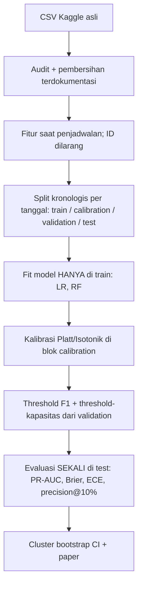

# TTKI P5 — Threshold, Kalibrasi, dan Prioritisasi Pasien Berisiko No-Show

Repositori eksperimen untuk tugas TTKI (PENS, Semester 5, Topik **P5 — Health Information System: no-show**).

> **Pertanyaan penelitian.** Apakah optimasi threshold dan kalibrasi probabilitas meningkatkan kualitas prioritisasi pasien berisiko no-show pada kapasitas pengingat 10%?

Seluruh angka pada paper wajib berasal dari berkas di `results/` yang dihasilkan skrip repo ini dari **CSV Kaggle asli**.
Repo ini **tidak berisi hasil apa pun** sampai Anda menjalankannya.

## Status
- [ ] CSV Kaggle diunduh, `data/README.md` terisi (tanggal, checksum, lisensi)
- [ ] `pytest -q` lulus
- [ ] `python -m src.run_experiments ...` dijalankan pada CSV asli
- [ ] Gambar dibuat, paper diisi dari `results/`
- [ ] Tag rilis final: `v1.0-final`

## Menjalankan
```bash
git clone <URL_REPO_KELOMPOK>
cd ttki-noshow
python -m venv .venv
# Windows: .venv\Scripts\activate    |  Linux/macOS: source .venv/bin/activate
pip install -r requirements.txt
python -m pip freeze > environment-freeze.txt

pytest -q                                            # uji anti-leakage + smoke test (data dummy)

# 1) letakkan CSV Kaggle di data/raw/ (lihat data/README.md), lalu:
python -m src.run_experiments --data data/raw/KaggleV2-May-2016.csv                       # skenario utama
python -m src.run_experiments --data data/raw/KaggleV2-May-2016.csv --feature-set no_proxy # ablation etika
python -m src.make_figures --results results/full --out figures
```
Waktu jalan ± beberapa menit pada laptop biasa (RF 5 seed + 500 bootstrap). Untuk uji cepat: `--n-boot 50 --rf-seeds 1`.

## Desain eksperimen (dibekukan di `src/config.py`)
| Komponen | Keputusan |
|---|---|
| Unit observasi | 1 janji temu; kelas positif = no-show |
| Split | **Kronologis menurut tanggal janji temu**, tidak memotong satu hari: train ≈60% → calibration ≈10% → validation ≈15% → test ≈15% (persentase aktual dilaporkan di `split_summary.csv`) |
| Fitur | umur, `waiting_days`, jam penjadwalan, hari-dalam-minggu, gender, neighbourhood, scholarship, hipertensi, diabetes, alkoholisme, handicap (0/1/2+), `SMS_received`. **Dilarang:** `PatientId`, `AppointmentID` |
| Model | Logistic Regression (tanpa class weight, deterministik) dan Random Forest (5 seed). **Tanpa** resampling/class weight agar arti probabilitas terjaga |
| Baseline | LR & RF, threshold 0,5 |
| Skenario A | Threshold dioptimalkan (max F1) **hanya pada validation** |
| Skenario B | Kalibrasi Platt dan isotonik, di-fit **hanya pada blok calibration** |
| Skenario C | Pilih **top 10%** skor tertinggi pada test (simulasi kapasitas outreach) + threshold-kapasitas dari validation |
| Metrik | PR-AUC (utama), ROC-AUC, Brier, log loss, ECE, slope/intercept kalibrasi, precision@10%, recall@10%, lift@10%, selisih outreach-rate realisasi vs target 10% |
| Ketidakpastian | Cluster bootstrap per `PatientId` (500×) → CI 95%; selisih berpasangan di `paired_deltas.csv`; RF 5 seed (`metrics_seed_summary.csv`) |
| Ablation etika | `--feature-set no_proxy` menghapus gender, neighbourhood, scholarship |

Catatan teoretis yang perlu dibahas di paper: kalibrasi sigmoid (Platt) bersifat monoton ketat sehingga **tidak mengubah ranking** → PR-AUC dan precision@10% identik; efeknya muncul pada Brier/ECE dan pada perilaku threshold. Isotonik dapat menghasilkan skor kembar (ties) sehingga ranking dapat sedikit berubah (ties diputus acak dengan seed tetap).

## Struktur
```
src/            config, data (audit+bersih), features, splits, models (+kalibrator), metrics, run_experiments, make_figures
tests/          uji anti-leakage, split, kalibrator, metrik, smoke test (tests/synthetic_fixture.py = DATA DUMMY, bukan untuk paper)
data/README.md  provenance Kaggle (CSV tidak di-commit)
results/<fs>/   data_audit.json, cleaning_log.json, split_summary.csv, daily_summary.csv, metrics_primary.csv,
                metrics_all_seeds.csv, metrics_seed_summary.csv, paired_deltas.csv, thresholds.csv,
                test_predictions.csv, run_config.json
figures/        gambar untuk paper
references/     literature_matrix.csv
paper/          naskah (DOCX/LaTeX) + response_to_review
```

## Alur (Mermaid)


## Aturan integritas (dari buku petunjuk)
- Jangan menyalin angka dari README/repo lain. Repo referensi `Rachel-Oyeyemi/Medical-Appointment-No-Shows` memuat **metrik dari data sintetis**; kami hanya memakainya sebagai inspirasi alur kerja (tidak ada kode yang disalin). Perbedaan desain: kami tidak memakai class weight/`scale_pos_weight`, menambah blok kalibrasi terpisah, dan mengevaluasi kapasitas 10%.
- Jangan mengubah `src/config.py` atau aturan setelah melihat hasil test. Jika harus, catat di bagian bawah.
- `SMS_received` bersifat observasional: jangan menyimpulkan efek kausal SMS.
- Jangan commit `kaggle.json`, token, atau CSV.
- Pemakaian bantuan AI untuk kode/naskah wajib dilaporkan sesuai kebijakan kelas dan seluruh hasil diverifikasi sendiri.

## Perubahan protokol (isi jika ada)
| Tanggal | Perubahan | Alasan | Dilakukan sebelum/sesudah melihat test? |
|---|---|---|---|
| | | | |

## Atribusi & lisensi
Kode: MIT (lihat `LICENSE`). Dataset: © pemilik Kaggle sesuai lisensi di halaman dataset (lihat `data/README.md`). Referensi: `references/literature_matrix.csv`.
